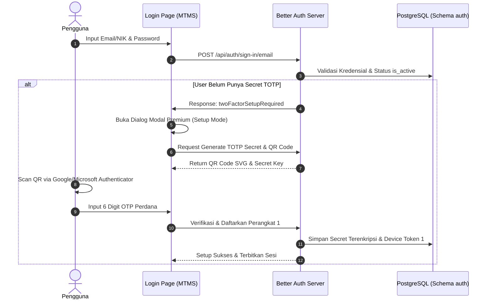
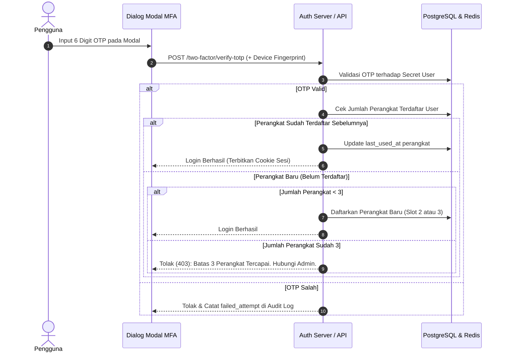

# Rencana Arsitektur & Kebijakan: MFA TOTP Authenticator, Manajemen Perangkat & Audit Autentikasi MTMS

Dokumen ini memuat seluruh rancangan arsitektur, kebijakan keamanan, alur kerja, skema database, dan rencana implementasi sistem **Multi-Factor Authentication (MFA) berbasis TOTP (Google/Microsoft Authenticator)**, **Kebijakan Batas Maksimal 3 Perangkat Terdaftar**, dan **Sistem Audit Log Autentikasi** untuk Monitoring Transaction Material's System (MTMS).

---

## 1. Ringkasan Eksekutif & Tujuan

Berdasarkan keputusan bisnis, MTMS menetapkan penggunaan **MFA TOTP Authenticator** standar industri (RFC 6238) dengan alasan:
1. **Profesional & Terstandarisasi:** Menggunakan aplikasi autentikator resmi (Google Authenticator, Microsoft Authenticator) yang sudah umum digunakan di lingkungan korporat tanpa perlu instalasi aplikasi internal terpisah.
2. **Keamanan Berlapis:** Melindungi akun staf dan manajemen dari pembajakan kata sandi atau *credential stuffing*.
3. **Kendali Perangkat (Device Governance):** Membatasi akses akun maksimal pada **3 perangkat fisik terpercaya (*trusted devices*)**.
4. **Transparansi & Forensik Keamanan:** Setiap aktivitas autentikasi (login, logout, kickout *single-session*, perubahan perangkat, dan kegagalan verifikasi) tercatat secara komprehensif dalam log audit.

---

## 2. Kebijakan Keamanan (Security Policies) MTMS

| Aspek Kebijakan | Ketetapan Kebijakan | Deskripsi & Penegakan |
| :--- | :--- | :--- |
| **Cakupan Pengguna** | **Seluruh Pengguna Wajib** | Berlaku wajib tanpa kecuali untuk seluruh role (Admin, Supervisor, dan Staff). |
| **Metode MFA** | **TOTP (RFC 6238)** | Kode 6 digit berbasis waktu (jendela 30 detik, algoritma SHA-1 standar Google/Microsoft Authenticator). |
| **Batas Perangkat** | **Maksimal 3 Perangkat** | Satu akun hanya dapat memiliki maksimal 3 perangkat terdaftar aktif. Login dari perangkat ke-4 diblokir dan diarahkan untuk menghubungi Admin. |
| **Identifikasi Perangkat** | **Device Fingerprint + Cryptographic Token** | Browser/perangkat ditandai menggunakan kombinasi *fingerprint* hardware/browser dan token terenkripsi (`HttpOnly`, `SameSite=Strict`). |
| **Anti-Replay OTP** | **Single-Use per Window** | Kode OTP yang sudah sukses digunakan tidak dapat dipakai kembali dalam jendela 30 detik yang sama untuk mencegah serangan replay. |
| **Rate Limiting MFA** | **Maksimal 5x Gagal / 15 Menit** | Mencegah *brute-force* OTP. Akun akan dikunci sementara (*lockout*) selama 15 menit jika gagal 5 kali berturut-turut. |
| **Kerahasiaan Seed** | **AES-256-GCM Encryption** | Secret TOTP tidak pernah disimpan dalam bentuk plaintext di database; wajib dienkripsi menggunakan `MFA_ENCRYPTION_SECRET`. |
| **Akses Manajemen** | **Admin / Non-Staff Only** | Menu manajemen perangkat dan aksi **Reset MFA** hanya dapat diakses oleh Admin via hak akses `requireManagementAccess()`. |
| **Reusabilitas Komponen** | **Login & Cancel InOut Tag** | Dialog modal MFA didesain modular dan reusable, digunakan untuk autentikasi login serta otorisasi aksi kritis transaksi (misal: Cancel InOut Tag). |
| **Audit Jejak Aktivitas** | **Immutability Log** | Semua log login, logout (termasuk alasan), dan reset perangkat disimpan dalam tabel append-only tanpa izin penghapusan oleh user biasa. |

---

## 3. Alur Kerja Sistem (System Workflows)

### 3.1 Alur Registrasi Perangkat & Setup MFA (Pertama Kali)


### 3.2 Alur Login Harian & Pengecekan Batas 3 Perangkat


---

## 4. Desain UI/UX: Modal Dialog MFA Premium

Modal didesain ringkas, fokus, elegan (*clean enterprise UI*), dan beranimasi halus:
- **Ukuran:** Maksimal lebar `max-w-md` (sekitar 400px - 440px), tidak memenuhi layar secara berlebihan.
- **Isi Konten:**
  1. **Header:** Logo MTMS, judul (*"Verifikasi Dua Langkah"*), dan subjudul informatif.
  2. **Area QR Code (Hanya Mode Setup):** Tampilan QR Code kontras tinggi dengan border halus, indikator aplikasi pendukung (*Google Authenticator / Microsoft Authenticator*), dan opsi *Copy Manual Key*.
  3. **Slot Input OTP:** Menggunakan primitif `src/components/ui/input-otp.tsx` (6 slot digit terpisah dengan efek fokus cincin primer dan animasi caret).
  4. **Tombol Aksi:** Tombol primer *"Verifikasi"* (dengan loading spinner state) dan tombol sekunder *"Batal"*.
- **Animasi (Framer Motion / Tailwind Transitions):**
  - Efek *backdrop blur* halus pada overlay (`backdrop-blur-sm`).
  - Animasi kemunculan modal: *scale up* dari `0.95` ke `1.0` disertai *fade in* 200ms.
  - Animasi *shake* halus pada slot OTP jika kode salah.

---

## 5. Manajemen Perangkat di Tabel Pengguna (`/management/users`)

Untuk mempermudah Administrator dalam mengelola akses akun karyawan (khusus non-staff):

1. **Kolom Status MFA:**
   - Badge hijau: `MFA Aktif (x/3 Perangkat)`.
   - Badge abu-abu: `Belum Diatur`.
2. **Tombol Aksi Kelola Perangkat:**
   - Tombol ikon gawai/shield yang membuka popover/modal ringkas daftar perangkat aktif milik user tersebut (misal: "Chrome on macOS - Terakhir aktif 10 menit lalu", "Samsung Internet on Android - Terakhir aktif kemarin").
3. **Tombol "Reset MFA":**
   - Mengaktifkan tombol `Reset MFA` yang sebelumnya berstatus *"Segera Hadir"*.
   - Saat diklik: Muncul konfirmasi destruktif (*AlertDialog*).
   - Efek Reset: Menghapus secret TOTP dan seluruh daftar perangkat terpercaya user tersebut, serta mencatat aksi admin ke dalam audit log. User wajib melakukan setup QR Code baru pada login berikutnya.

---

## 6. Arsitektur Audit Autentikasi (`auth.auth_audit_logs`)

Setiap peristiwa autentikasi dicatat secara terstruktur untuk audit forensik:

### Tipe Event (`event_type`):
- `LOGIN_CREDENTIAL_SUCCESS`: Kata sandi benar, menunggu verifikasi OTP.
- `LOGIN_CREDENTIAL_FAILED`: Percobaan password salah.
- `MFA_VERIFIED_SUCCESS`: OTP berhasil diverifikasi.
- `MFA_VERIFIED_FAILED`: Percobaan OTP salah / kadaluarsa.
- `DEVICE_REGISTERED`: Perangkat baru (slot 1, 2, atau 3) berhasil didaftarkan.
- `DEVICE_LIMIT_BLOCKED`: Ditolak karena mencoba login dari perangkat ke-4.
- `LOGOUT_MANUAL`: Pengguna menekan tombol Sign Out secara sadar.
- `LOGOUT_CONCURRENT_KICK`: Sesi ditutup otomatis karena login di perangkat lain (*single session enforcement*).
- `LOGOUT_SESSION_EXPIRED`: Sesi habis masa berlakunya (10 jam *hard deadline*).
- `MFA_RESET_BY_ADMIN`: MFA di-reset oleh admin.

### Kolom Data Audit:
- `id` (UUID / Bigint PK)
- `user_id` (Text / references `auth.user.id`)
- `nik` (Text)
- `event_type` (Varchar 50)
- `status` (`SUCCESS` / `FAILED` / `BLOCKED`)
- `ip_address` (Varchar 45, support IPv4/IPv6)
- `user_agent` (Text)
- `device_name` (Varchar 100, misal "Windows 11 / Chrome 124")
- `device_fingerprint` (Varchar 64, SHA-256 hash)
- `reason` (Text, keterangan detail kegagalan/logout)
- `metadata` (JSONB)
- `created_at` (Timestamptz default `CURRENT_TIMESTAMP`)

---

## 7. Skema Database PostgreSQL Baru (Migrasi `060`)

```sql
-- 1. Tabel Dua Faktor Better Auth (di schema auth)
CREATE TABLE IF NOT EXISTS auth."twoFactor" (
    id TEXT PRIMARY KEY,
    "secret" TEXT NOT NULL,
    "backupCodes" TEXT NOT NULL,
    "userId" TEXT NOT NULL REFERENCES auth."user"(id) ON DELETE CASCADE,
    "verified" BOOLEAN DEFAULT TRUE,
    "failedVerificationCount" INTEGER DEFAULT 0,
    "lockedUntil" TIMESTAMPTZ,
    "createdAt" TIMESTAMPTZ NOT NULL DEFAULT CURRENT_TIMESTAMP
);
CREATE INDEX IF NOT EXISTS idx_twofactor_user_id ON auth."twoFactor" ("userId");

-- 2. Tabel Perangkat Terdaftar (Maksimal 3 per user)
CREATE TABLE IF NOT EXISTS auth.user_trusted_devices (
    id TEXT PRIMARY KEY,
    user_id TEXT NOT NULL REFERENCES auth."user"(id) ON DELETE CASCADE,
    device_name TEXT NOT NULL,
    device_fingerprint TEXT NOT NULL,
    user_agent TEXT,
    ip_address TEXT,
    last_used_at TIMESTAMPTZ NOT NULL DEFAULT CURRENT_TIMESTAMP,
    created_at TIMESTAMPTZ NOT NULL DEFAULT CURRENT_TIMESTAMP,
    is_revoked BOOLEAN NOT NULL DEFAULT FALSE,
    revoked_at TIMESTAMPTZ,
    revoked_by TEXT
);
CREATE INDEX IF NOT EXISTS idx_trusted_devices_user_id ON auth.user_trusted_devices (user_id);
CREATE INDEX IF NOT EXISTS idx_trusted_devices_fingerprint ON auth.user_trusted_devices (user_id, device_fingerprint);

-- 3. Tabel Audit Log Autentikasi
CREATE TABLE IF NOT EXISTS auth.auth_audit_logs (
    id BIGSERIAL PRIMARY KEY,
    user_id TEXT REFERENCES auth."user"(id) ON DELETE SET NULL,
    nik TEXT,
    event_type VARCHAR(50) NOT NULL,
    status VARCHAR(20) NOT NULL,
    ip_address VARCHAR(45),
    user_agent TEXT,
    device_name TEXT,
    device_fingerprint TEXT,
    reason TEXT,
    metadata JSONB,
    created_at TIMESTAMPTZ NOT NULL DEFAULT CURRENT_TIMESTAMP
);
CREATE INDEX IF NOT EXISTS idx_auth_audit_logs_user_id ON auth.auth_audit_logs (user_id);
CREATE INDEX IF NOT EXISTS idx_auth_audit_logs_created_at ON auth.auth_audit_logs (created_at DESC);
CREATE INDEX IF NOT EXISTS idx_auth_audit_logs_event_type ON auth.auth_audit_logs (event_type);
```

---

## 8. Rencana Tahapan Eksekusi

1. **Fase 1: Database & Backend Core**
   - Buat file migrasi `060_setup_mfa_totp_and_auth_audit.sql`.
   - Update Kysely `database.types.ts`.
   - Aktifkan plugin `twoFactor` di `src/lib/auth.ts` dan `src/lib/auth-client.ts`.
   - Implementasikan service `trusted-device.service.ts` untuk memvalidasi batas maksimal 3 perangkat.
   - Implementasikan service `audit-auth.service.ts` untuk mencatat login/logout/alasan.

2. **Fase 2: Komponen Dialog Modal MFA Premium**
   - Buat komponen `src/app/auth/components/MfaModal.tsx` menggunakan Radix Dialog + Framer Motion + `InputOTP`.
   - Hubungkan ke flow halaman login (`src/app/auth/login/page.tsx`).

3. **Fase 3: Manajemen Perangkat & Reset MFA di Tabel Pengguna**
   - Perbarui `src/app/(DashboardLayout)/management/users/user-table.tsx` untuk menampilkan badge MFA dan aksi kelola 3 perangkat.
   - Fungsikan tombol `Reset MFA` di `src/app/(DashboardLayout)/management/users/actions.ts`.

4. **Fase 4: Testing & Verifikasi**
   - Unit test untuk limit 3 perangkat & audit logging.
   - Typecheck (`tsc`), linting (`biome`), dan build (`pnpm build`).

